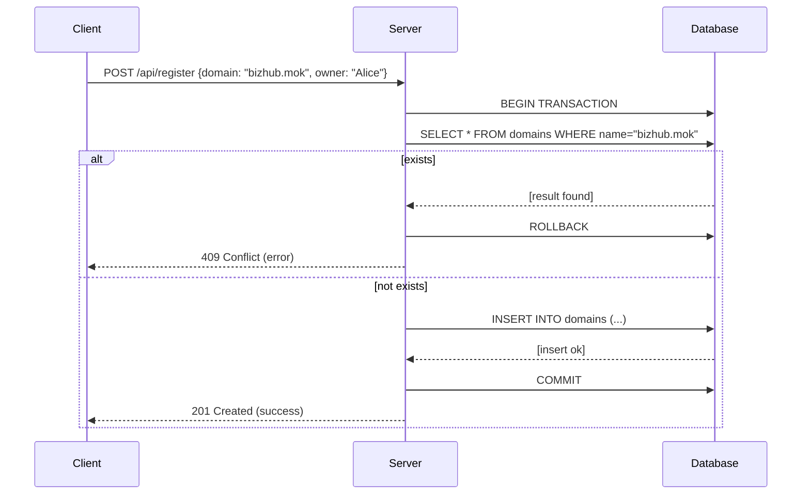
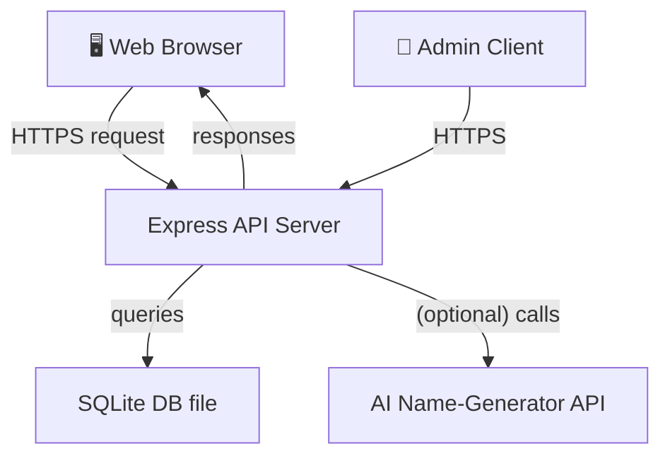
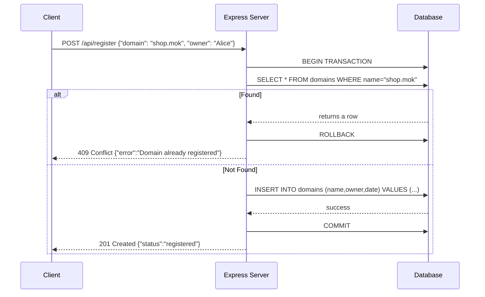

# Executive Summary

The **Mtaani AI Domain System** is a web application to generate creative domain-name suggestions from a user’s input, check their availability, and manage a custom registry of “powered” domains. This report covers a complete design and deployment guide for such a system, including **frontend**, **backend/API**, **AI-based name generation**, **database schema**, **security**, and **deployment** considerations. We assume payments are disabled (no actual registrar integration) and focus on ensuring uniqueness and reliability. The user’s provided TLDs (.mok, .kyx, .dom) have fixed prices (KES 100, 50, 150 respectively) but are treated as custom extensions rather than official DNS domains. The report is bilingual (English/Swahili) and uses primary documentation sources (Node.js/Express, better-sqlite3, PostgreSQL, hosting provider docs) where possible. 

## System Architecture

The system consists of three main layers:

- **Frontend (Client UI)** – A web interface (HTML/CSS/JS or a SPA framework) where users input a business idea or keywords. The sample code uses static HTML with TailwindCSS and JavaScript (see user-provided code). This sends requests to the backend API.
- **Backend (Node.js/Express)** – Implements REST APIs for name generation, availability checks, and registry management. It interfaces with the database and (optionally) an AI service.
- **Database (SQLite / PostgreSQL)** – Stores the registry of powered domains (with schema enforcing unique names). SQLite can be used for development or low traffic, but for higher traffic/production we recommend PostgreSQL.
- **AI Component** – (Optional) A service (e.g. OpenAI/GPT) to generate creative name suggestions from input. Fallback logic (prefix/suffix heuristics) is also included if no AI is used.
- **Admin Interface/API** – Admin-only endpoints or UI to manage the registry, protected by an API key.

```mermaid
flowchart LR
    subgraph Browser(Client UI)
      A[User Interface]
    end
    subgraph Server(Backend & DB)
      B[Express Server]
      C[(SQLite/PG Database)]
    end
    subgraph AI_Service
      D[OpenAI / Name Generator]
    end
    A -->|HTTPS API| B
    B -->|DB queries| C
    B -->|Calls if needed| D
    AdminUI -->|API key| B
    B --> A
```

The **browser** communicates via HTTPS to the Express API. The server reads/writes the **database** (better-sqlite3 for SQLite or `pg` for Postgres). If AI is enabled, the server calls an AI API (e.g. OpenAI) to generate names. The admin interface also talks to the same Express server, using a special API key (in headers or a token) for authentication.

## REST API Design

We define clear REST endpoints. Each uses JSON I/O and appropriate HTTP status codes. Protected endpoints (e.g. registering a domain) require an **Admin API key** (sent via `Authorization: Bearer <key>` header or similar).

### Endpoints

- **POST `/api/generate`** – Generate domain suggestions.  
  - **Input JSON**: `{ "idea": "kitchen business", "github": "github.com/user/repo" }` (at least one of `idea` or `github` required).  
  - **Response JSON**: `{ "suggestions": ["kitchenpro.com", "getkitchen.io", ...] }`.  
  - This may call an AI (if configured) or use built-in heuristics (prefixes/suffixes) to create names (see *AI Name Generation*).

- **GET `/api/check?domain=name.mok`** – Check availability of a single domain.  
  - **Query Param**: `domain` (full domain name with one of .mok/.kyx/.dom).  
  - **Response JSON**: `{"domain":"name.mok","state":"free"}` or `"taken"` or `"powered"`, plus optional expiry.  
  - The server checks our **powered registry** database and, if not present, may optionally query an external DNS/RDAP (see *Domain Availability*).

- **POST `/api/register`** – Register (“power on”) a domain. **Admin only.**  
  - **Header**: `Authorization: Bearer <ADMIN_KEY>`  
  - **Input JSON**: `{ "domain": "name.mok", "owner": "MtaaniClient" }`.  
  - **Response**: `201 Created` on success, or `409 Conflict` if the name is already taken/powered.  
  - This endpoint does: 1) Validate name, 2) Start DB transaction, 3) Ensure not already in DB (unique constraint), 4) Insert record, commit.

- **GET `/api/powered`** – List all powered domains in the registry.  
  - **Header**: `Authorization: Bearer <ADMIN_KEY>`  
  - **Response JSON**: `{"domains":[{"name":"x.mok","owner":"Mtaani","date":"2026-10-12T10:00"},{"name":"y.kyx",...},...]}`.  
  - Returns all (or paginated) domains saved.

- **GET `/api/health`** (optional) – Health check for uptime, returns `200 OK` and version.

These endpoints align with RESTful best practices (resources are nouns, use GET/POST appropriately, use proper HTTP codes). Example cURL for checking a domain:

```bash
curl "https://api.example.com/api/check?domain=kitchenpro.mok"
# Response: {"domain":"kitchenpro.mok","state":"free"}
```

### Example Request/Response

```http
POST /api/register
Authorization: Bearer SECRET_ADMIN_KEY
Content-Type: application/json

{"domain": "bizhub.kyx", "owner": "MtaaniUser"}
```
**Response** (success):
```json
HTTP/1.1 201 Created
{"status":"registered","name":"bizhub.kyx"}
```
**Response** (already exists):
```json
HTTP/1.1 409 Conflict
{"error":"Domain already registered"}
```

### OpenAPI Spec Snippet

Below is a minimal OpenAPI/Swagger spec illustrating these endpoints. (In production, expand with schemas and examples.)

```yaml
openapi: "3.0.0"
info:
  title: Mtaani Domain API
  version: "1.0"
paths:
  /api/generate:
    post:
      summary: Generate domain suggestions
      requestBody:
        required: true
        content: 
          application/json:
            schema:
              type: object
              properties:
                idea: { type: string }
                github: { type: string }
      responses:
        '200':
          description: List of suggestions
          content:
            application/json:
              schema:
                type: object
                properties:
                  suggestions:
                    type: array
                    items: { type: string }
  /api/check:
    get:
      summary: Check domain availability
      parameters:
        - in: query
          name: domain
          schema: { type: string }
      responses:
        '200':
          description: Availability status
          content:
            application/json:
              schema:
                type: object
                properties:
                  domain: { type: string }
                  state: { type: string, enum: [free,taken,powered] }
                  expires: { type: string, nullable: true }
  /api/register:
    post:
      summary: Register a domain (Admin)
      security:
        - bearerAuth: []
      requestBody:
        required: true
        content:
          application/json:
            schema:
              type: object
              properties:
                domain: { type: string }
                owner: { type: string }
      responses:
        '201': { description: Domain registered }
        '409': { description: Already registered }
  /api/powered:
    get:
      summary: List powered domains (Admin)
      security:
        - bearerAuth: []
      responses:
        '200':
          description: List of domains
          content:
            application/json:
              schema:
                type: object
                properties:
                  domains:
                    type: array
                    items:
                      type: object
                      properties:
                        name: { type: string }
                        owner: { type: string }
                        date: { type: string }
components:
  securitySchemes:
    bearerAuth:
      type: http
      scheme: bearer
      bearerFormat: API Key
```

## Database Schema and Uniqueness

We design a **domains** table to store each registered (powered) domain with unique name constraint:

- **SQL Schema (SQLite/Postgres)**:
  ```sql
  CREATE TABLE domains (
    name TEXT PRIMARY KEY,        -- domain name, e.g. "bizhub.mok"
    owner TEXT NOT NULL,          -- owner label
    date TIMESTAMP NOT NULL       -- datetime of registration
  );
  ```
  In Postgres, use `VARCHAR` instead of `TEXT` if desired. The `PRIMARY KEY` or `UNIQUE` on `name` enforces no duplicates.

- **Pricing Table (optional)**:
  If needed, a small table or config for TLD prices:
  ```sql
  CREATE TABLE tld_prices (
    tld TEXT PRIMARY KEY,
    price INTEGER NOT NULL
  );
  INSERT INTO tld_prices (tld, price) VALUES 
    ('.mok', 100), ('.kyx', 50), ('.dom', 150);
  ```
  The application can read these for display or logic. (Payments are disabled, so price is informational.)

- **SQL Transactions for Atomicity**:  
  To prevent race conditions (two users powering the same domain simultaneously), wrap check-and-insert in a transaction. For example in better-sqlite3:
  ```js
  const insertDomain = db.prepare(
    'INSERT INTO domains (name, owner, date) VALUES (?, ?, ?)'
  );
  const register = db.transaction((name, owner) => {
    const exists = db.prepare('SELECT 1 FROM domains WHERE name = ?').get(name);
    if (exists) throw new Error('Conflict');
    insertDomain.run(name, owner, new Date().toISOString());
  });
  // Usage:
  try {
    register(domainName, owner);
    // success: 201 Created
  } catch (e) {
    // if e.message is 'Conflict', handle 409 Conflict
  }
  ```
  The [`db.transaction()`](https://github.com/WiseLibs/better-sqlite3/blob/master/docs/api.md#transaction) function ensures the block runs in one atomic SQLite transaction. If an error occurs, it rolls back automatically.

  In PostgreSQL, you can do similarly with `BEGIN;` / `COMMIT;` or use `INSERT ... ON CONFLICT DO NOTHING;` and check affected rows. A unique constraint on `name` will cause an error on duplicates, which you catch and handle.

- **Concurrency**:  
  *SQLite* is file-based and serializes writes. With better-sqlite3 (synchronous API), concurrent Node.js requests queue naturally, but use transactions as above to avoid partial inserts. For **Postgres**, use a real DB with isolation levels; a `SERIALIZABLE` or `READ COMMITTED` isolation will prevent dirty reads. Additionally, the unique constraint ensures only one succeeds.



The above sequence shows how we detect and prevent duplicate registrations using a transaction. The primary key ensures **uniqueness** even under concurrent requests.

## Domain Name Validation Rules

Domains must be checked for valid format and allowed TLD. Per DNS rules:

- Each label (the part before a dot) must be 1–63 characters of `a-z0-9-`.
- It **must** start and end with a letter or digit (not a hyphen).
- Overall length ≤255 characters (trivially satisfied for our short names).
- Top-level domain must be one of your custom set `.mok`, `.kyx`, `.dom` (case-insensitive).

For example, a regex in JavaScript could be:
```js
const domainRegex = /^(?=.{3,255}$)([a-z0-9]+(-[a-z0-9]+)*)(\.(mok|kyx|dom))$/;
if (!domainRegex.test(name)) {
  // Invalid: return error
}
```
This enforces the label rules and only allows the three custom TLDs. (Note: we don’t check IANA TLD list because `.mok`, `.kyx`, `.dom` are custom.)

*Mfano:* Matumizi yake:
```js
validateDomain("kitchenpro.mok");  // true
validateDomain("-x.mok");         // false (starts with hyphen)
validateDomain("abc.xyz");        // false (xyz not allowed TLD)
```

## AI Name-Generation Logic

To generate creative suggestions, we can incorporate an AI model or heuristic:

- **OpenAI GPT-4 (optional)**: You may call the OpenAI API from Node.js using `npm install openai`. For example:
  ```js
  import OpenAI from "openai";
  const openai = new OpenAI({ apiKey: process.env.OPENAI_API_KEY });
  const resp = await openai.chat.completions.create({
    model: "gpt-4",
    messages: [{ role: "user", content: `Generate catchy domain names (with .mok/.kyx/.dom) for a business: "${input}"` }]
  });
  const suggestions = JSON.parse(resp.choices[0].message.content);
  ```
  This way, GPT generates a list like `["goCooking.mok","myKitchenio.kyx",...]`. (You’d parse it into JSON or text.)
  
- **Fallback logic**: If no AI key is available, use simple algorithms: strip spaces, add prefixes/suffixes (e.g. from user’s code: `PREFIXES = ['get','try',...]`, `SUFFIXES = ['ly','io','hub',...]`). For example:
  ```js
  function generateNames(input) {
    const words = input.toLowerCase().split(/\W+/).filter(w => w.length>1);
    const main = words[0];
    let set = new Set();
    set.add(words.join(''));
    set.add(main);
    if (words.length>1) {
      set.add(words.join('-'));
      set.add(main+words[1]);
    }
    ['get','try','my','go','use','hey'].forEach(p => set.add(p + words.join('')));
    ['ly','hub','io','pro','spot','lab','base','ify'].forEach(s => set.add(main + s));
    // ... truncate, filter short, add .com or our TLDs:
    return Array.from(set).map(n => n.substring(0,20)+".mok");
  }
  ```
  This is similar to the user-provided `generateNames()`.

If using AI, consider rate-limiting since API calls cost money and have latency. Provide a fallback in your code or cache results.

## Pricing and Payments Mode

Per user data, we have fixed prices (KES 100 for `.mok`, 50 for `.kyx`, 150 for `.dom`). Since **payments are disabled**, we simply store these in config or a table for reference, but do not implement checkout. In code, you might have:
```js
const prices = { ".mok": 100, ".kyx": 50, ".dom": 150 };
```
When presenting results (e.g. in the UI summary), you could show prices, but the **Buy** button would not process payments.  

**Mbali na hayo**, ensure your checkout or “Buy” links are disabled (as per user request: “but payment usiwashe”). The registry only records the name and owner upon manual “register”.

## Deployment and Hosting Options

The Node.js/Express server is dynamic, so it must run on a server or PaaS (Platform-as-a-Service). Below is a comparison of hosting choices:

| Option                         | Strengths                                     | Trade-offs                                       | Good for                          |
|--------------------------------|-----------------------------------------------|--------------------------------------------------|-----------------------------------|
| **Vercel/Netlify**             | Git-based deploy, CDN, great for static sites | Serverless functions have execution limits; cost may rise with heavy use | Static frontend, Next.js apps     |
| **Render/Railway**             | Runs Node.js servers and databases easily     | Free tier sleeps; usage-based pricing on scale   | APIs, small backend services      |
| **DigitalOcean/VPS (Hetzner, Linode)** | Full control (SSH, docker), predictable cost     | You handle OS updates, security, backups yourself | Custom stacks, high control       |
| **Heroku (no free tier)**      | Easy deploy, managed; many addons (Postgres)  | Now paid-only; free tier removed; container limits | Quick deployments (paid plans)    |

*(Table adapted from industry guides.)*

For this project, **Render** or a small **VPS** is recommended for a low-cost dynamic Node app. For example:
- **Render**: Free for small apps. You can deploy by connecting to GitHub. It provides an auto-assigned `process.env.PORT` (use in `app.listen`). It's straightforward for Express + SQLite or Postgres (Connect a managed DB).
- **VPS**: e.g. DigitalOcean (~$5/mo). You’d provision a server, install Node, and run your app (possibly using PM2 or Docker). You get full control and a static IP/domain (suitable for DNS).
- **Static site/CDN**: If only front-end (no dynamic API), you could use Vercel/Netlify. But we need a server for the database & logic, so static alone is not sufficient.

**Deployment Steps (general)**:
1. **Set environment variables**. Use a `.env` file in development (with `dotenv`) and set vars in the host’s config:
   ```
   PORT= (optional, override by host usually)
   ADMIN_KEY=<your-secret-key>
   OPENAI_API_KEY=<if used>
   DB_PATH=./data/mtaani.db        # for SQLite
   ```
2. **Database**: If SQLite, ensure the directory is writable. For production, consider managed Postgres:
   - On VPS, install Postgres and create the `domains` table (see schema above).
   - On Render, use a Postgres add-on or Railway for DB, and adjust connection string (`DATABASE_URL`).
   - Migrate by copying data or using `.dump`/`pg_dump`.
3. **Run server**: `node server.js`. The medium guide notes: use `process.env.PORT` when calling `app.listen`, not a hard-coded port. E.g. `app.listen(process.env.PORT || 3000)`.
4. **Backup**: If using SQLite, occasionally run `db.backup()` to save a copy (or simply copy the file). If using Postgres, set up regular dumps (`pg_dump`) or rely on managed backup features.
5. **DNS & Domain**: Point your website domain to the host. For a backend API, you might use a subdomain (e.g. `api.mydomain.com`) and enable SSL.
6. **Integrate Frontend**: If you have a separate website, your front-end JS can call the APIs above (e.g. via `fetch`). Provide the URLs in your integration.

## Environment Variables and Secrets

- **ADMIN_KEY**: A secret string (e.g. `process.env.ADMIN_KEY`) used to authenticate admin requests. Keep it secret and rotate if needed. Store only in env, not code.
- **Database Paths/URLs**: `DB_PATH` for SQLite file; or `DATABASE_URL` for Postgres connection. Do not commit credentials.
- **AI/API Keys**: Any OpenAI or other AI service keys. E.g. `OPENAI_API_KEY`.
- **Other**: If you use Stripe or email, those secrets go here too (not needed if payments off).

Use 12-factor app practice: do not hard-code secrets, but inject them via environment. E.g. in Node, `require('dotenv').config()` in development, and set vars in your deployment settings.

## Backup and Migration

- **SQLite**: Use `db.backup(destPath)` from better-sqlite3 to create a copy. Or on a cron, copy the `.db` file (ensure no writes during copy). For example:
  ```js
  db.backup('backup-mtaani.db')
    .then(() => console.log('Backup complete'))
    .catch(err => console.error('Backup failed', err));
  ```
- **PostgreSQL** (recommended for production): Use `pg_dump` for backups. E.g. `pg_dump -U user mtaani > dump.sql`. Many hosts offer automatic backups.  
- **Migration**: If you start with SQLite and need to switch to Postgres:
  1. Export SQLite data: e.g. `.dump domains`.
  2. Create Postgres schema (`CREATE TABLE ...`).
  3. Import data (adjust syntax if needed).
  Alternatively, use an ORM or a node migration tool (e.g. Knex) to transfer.

**Note:** For higher traffic, Postgres scales better (connections, concurrency) and avoids the file-locking limits of SQLite. Use it if you anticipate “medium or high” traffic (thousands of lookups).

## Security Best Practices

- **CORS**: Use the [`cors`](https://www.npmjs.com/package/cors) middleware in Express to restrict origins. Example: `app.use(cors({ origin: 'https://mydomain.com' }));` to allow only your site. (Otherwise browsers may block cross-site AJAX.)
- **Rate Limiting**: Throttle API calls to prevent abuse. Use [`express-rate-limit`](https://www.npmjs.com/package/express-rate-limit) to, for example, limit to 100 requests per minute per IP on the `/api/check` endpoint.
- **Input Sanitization**: Since we use prepared statements (better-sqlite3 or parameterized Postgres), SQL injection is mitigated. Still validate input formats (as above).
- **Admin Authentication**: Use a strong random API key for admin routes. Rotate this key periodically by changing the environment variable and updating any services that call it.
- **HTTP Security**: Run the app over HTTPS. Set HTTP headers (use [helmet](https://www.npmjs.com/package/helmet)) to protect against common vulnerabilities.
- **Logging of Sensitive Data**: Do not log secrets or personal user data. Log actions and errors for debugging but avoid printing API keys or passwords.

## Logging and Monitoring

Implement basic **logging** so you can audit usage and errors:

- **Request Logging**: Middleware like `morgan` can log each HTTP request (method, URL, status). 
- **Error Handling**: Catch and log errors in server routes. For example, log SQL errors or exceptions with `console.error(err)`.
- **Remote Logging**: On VPS or with services like Render, logs appear in the dashboard. For serious production, consider a log service (Winston + a transport to Datadog, Loggly, etc.).
- **Monitoring**: Keep an eye on uptime. Optionally add a `/health` endpoint and use a free monitor (e.g. uptimeRobot) to hit it. Monitor DB size and memory usage.
- **Alerting**: If a database error occurs (e.g. out of memory), have some alert (email or Slack). This can be set up with many hosted platforms.

## Deployment Steps / Checklist

1. **Prepare Environment**: 
   - Install Node.js (v18+). 
   - Use `dotenv` in dev; set required ENV variables.
2. **Initialize Project**: 
   - `npm init` and install dependencies: `express`, `better-sqlite3` (or `pg` for Postgres), `cors`, `express-rate-limit`, `dotenv`, etc.
3. **Database Setup**: 
   - If SQLite: simply ensure a writable folder (e.g. `data/`).  
   - If Postgres: create a database and user, run `CREATE TABLE domains ...`.
4. **Write Code**: 
   - `server.js` or `index.js`: set up Express, connect DB (e.g. `const db = new Database(process.env.DB_PATH);`).
   - Define routes as per API design. Use prepared statements/ORM.
   - Use `process.env.PORT` in `app.listen`.
5. **Test Locally**: 
   - Use `curl` or Postman to test each endpoint.
   - Example: `curl -X POST http://localhost:3000/api/generate -d '{"idea":"coffee shop"}'`.
6. **Version Control**: 
   - Commit code to Git (ignore `node_modules`, `.env`).
   - Push to GitHub (private or public).
7. **Deploy to Hosting**:
   - **Render**: Create a Web Service, link the GitHub repo, set build/start commands (e.g. `npm install` / `npm start`). Set ENV vars in the Render dashboard.
   - **VPS**: SCP files to server or use Git. Install Node. Run `npm install`, then `node server.js` or `pm2 start server.js`.
   - **Static Assets**: If a separate frontend, host static on Vercel/Netlify or on the same domain (Express can serve static files).
8. **DNS and SSL**: 
   - Point your domain (e.g. `ai.domain.com`) to the host’s IP or CNAME. 
   - Ensure SSL (Render provides https by default; On VPS, use Let’s Encrypt).
9. **Final Testing**: 
   - Confirm APIs respond over the internet. Use `curl` with the real domain.
   - Integrate frontend calls: update JavaScript to call your actual API URL.

```bash
# Example cURL calls:
curl -X POST https://yourapi.com/api/generate \
  -H "Content-Type: application/json" \
  -d '{"idea":"restaurant food"}'
curl "https://yourapi.com/api/check?domain=restaurantpro.mok"
curl -X POST https://yourapi.com/api/register \
  -H "Content-Type: application/json" \
  -H "Authorization: Bearer $ADMIN_KEY" \
  -d '{"domain":"restaurantpro.mok","owner":"Mtaani"}'
curl -X GET https://yourapi.com/api/powered \
  -H "Authorization: Bearer $ADMIN_KEY"
```

## Code Structure and Placement

Organize code for clarity. A suggested file layout:

```
/mtaani-domain-system
├─ server.js        # Main Express app
├─ routes/          # Route handlers
│   ├─ generate.js
│   ├─ check.js
│   ├─ register.js
│   └─ powered.js
├─ db/              # Database initialization or migrations
│   └─ init.js
├─ config.js        # Load env vars and config (ports, DB paths)
├─ package.json
├─ public/          # Static files (if serving frontend)
│   ├─ index.html
│   └─ main.js
└─ README.md
```

- **server.js**: Set up Express, middleware (CORS, JSON, rate limit), and import routes.
- **routes/**: Each file exports an Express router for that endpoint (e.g. `module.exports = router;`).
- **db/init.js**: Code to connect to DB and create tables if not exist.
- **config.js**: Centralize config (e.g. read `process.env` and export constants).
- **public/**: If using a static HTML+JS, either serve from Express (`app.use(express.static('public'))`) or deploy separately.

## Handling Traffic and Scaling

- **Low Traffic** (<1000/day): SQLite is fine. A single server handle the load. Monitor memory/CPU.
- **Medium Traffic** (thousands/day): Move to Postgres for concurrent writes. Use a process manager (PM2) or run in a container. 
- **High Traffic** (10k+/day): Consider clustering Node (PM2 cluster or Docker with multiple instances behind a load balancer). Use a managed DB cluster.

We recommend designing with scalability in mind: use environment configs, and follow 12-factor so you can switch DB or scale out without code rewrites.

## Security and Administration

- **Admin Usage**: The `/api/register` and `/api/powered` endpoints require the `Authorization` header with the admin key. Keep this key secret (e.g. in ENV) and use HTTPS so it’s not sniffed.
- **Key Rotation**: If an admin key leaks, generate a new one and update the `ADMIN_KEY` env var on the server. Re-deploy or restart the app so it uses the new key. Invalidating old tokens ensures old clients cannot register domains.

## Mermaid Diagrams

### Architecture Overview



### Domain Registration Sequence



Each step of the registration is atomic. If the SELECT finds an existing domain, we immediately roll back and return a conflict. Otherwise, we insert and commit.

## Conclusion

This report has outlined a **production-ready** design for the Mtaani AI Domain System. We covered everything from architecture to code structure, API design, database schema, security practices, and deployment. By following this guide and consulting the referenced documentation, one can implement a robust system to generate and register domains with custom TLDs. 

**Key Points:**
- Use **unique constraints and transactions** to avoid duplicates.
- Validate domain format per DNS rules, allowing only your TLDs.
- Secure admin endpoints with API keys and HTTPS.
- For production, prefer **PostgreSQL** over SQLite and use a PaaS (like Render) or VPS.
- Regularly backup the database and monitor logs.

With this setup, you can safely launch the Mtaani domain registrar system online, integrate it into your website, and scale it as needed.

